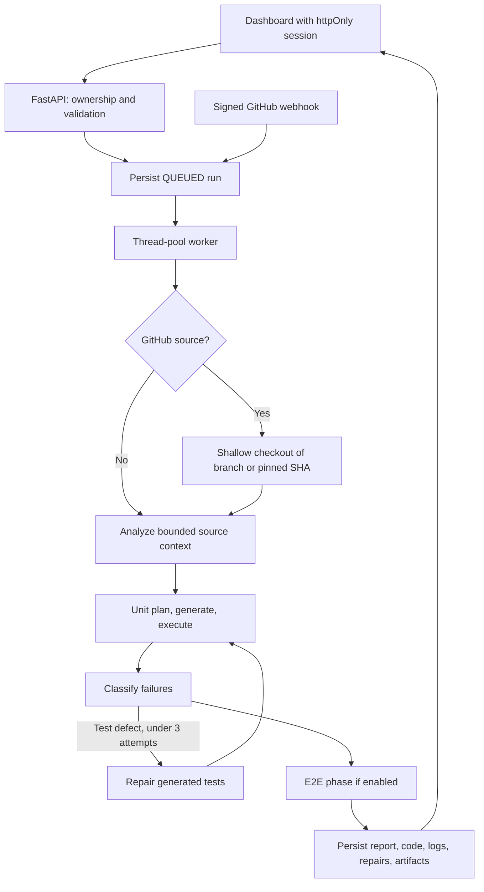

# Phase 2 implementation and validation

Verified on 7 October 2026 against the existing working tree. Existing Phase 2 backend work was continued, with a new dashboard and regression coverage added.

## Delivered

- Background thread-pool execution, queued runs, per-project serialization, cooperative cancellation, startup recovery, and persisted progress events.
- Project/run history, owner-scoped reports and artifact access, protected deletion while a worker is active, and detailed results including repairs.
- Email/password authentication, httpOnly cookie proxy, login/register/logout, profile, GitHub token, and per-user LLM preferences.
- All planned dashboard routes, a shared typed API client, reusable status/stepper/code/report components, loading/error states, and polling cleanup.
- Shallow GitHub clone, pinned PR SHA checkout, signed webhook handling, project webhook secret rotation, and optional PAT-backed PR summaries.
- Python Playwright generation, unit/E2E graph phases, Chromium execution, screenshots/traces, and JUnit-based individual test counts (including parameterization and skips).
- Alembic upgrade for provider preferences and structured test results, aligned dependency installation, Docker Compose command fixes, and updated setup documentation.

## Checks

- Backend: **38 passed** with `venv/bin/python -m pytest -q --disable-warnings`. Existing dependency/deprecation warnings remain.
- Frontend: `npm run lint` passed; `npm run build -- --webpack` passed, including TypeScript and all App Router routes. Turbopack failed to bind a build-worker port in this environment; webpack was used for validation.
- Browser: register → local project with both test types → queued worker → completed report with two passing tests → expanded generated Playwright code and logs.
- Browser: provider setting persisted after reload; logout and a fresh login restored the workspace.
- Browser: GitHub project creation exposed webhook setup; a real public checkout of octocat/Hello-World completed with its commit SHA recorded and a passing fake unit smoke test.
- Tests: queued cancellation, ownership boundaries for reports/events/artifacts, blocked deletion of active/cancelling runs, repeatable SQLite migration startup, repair attempt cap, source filename traversal protection, provider context isolation, pinned Git refs, structured parameterized/skipped results, and real Chromium failure screenshot/trace collection.

The browser preview used an isolated temporary SQLite database/workspace on API port 8001 and dashboard port 3001 with `USE_FAKE_LLM=true`. No real provider calls, private GitHub credentials, or PR comment writes were used. Provider model IDs were checked against the official catalogs linked in the README, and can be overridden in configuration.

## External setup still required

Provide LLM API keys for actual test generation. For private repositories and PR comments, save a PAT in Settings. Configure a public API/tunnel URL and install the project webhook in GitHub for real delivery. HMAC receiver logic is covered by tests; no webhook was installed in a real repository. PostgreSQL behavior was not exercised; migration tests used SQLite.

Phase 2 executes trusted code locally. Durable distributed workers, container isolation, GitHub delivery deduplication, token encryption at rest, and production deployment remain outside this implementation.

## Runtime flow

E2E-only projects skip the unit phase. Both phases share failure analysis and their own bounded repair counter. Cancellation is checked between graph nodes; the currently executing operation can complete first.
